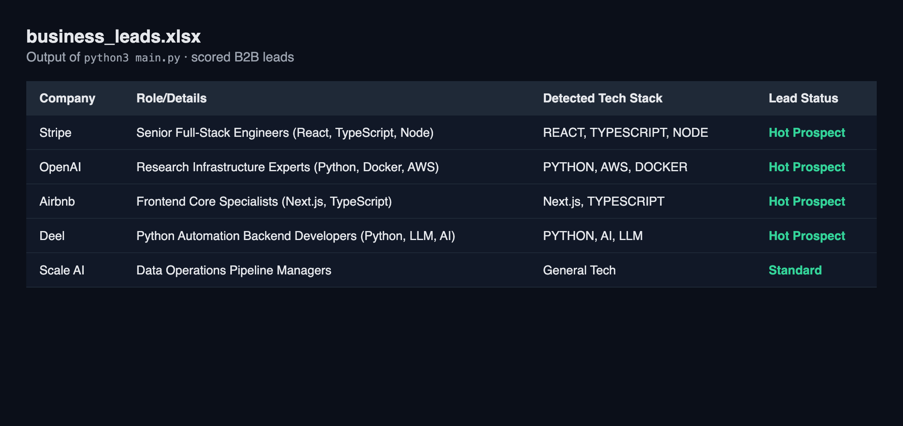

# Async B2B Lead & Job Scraper

An asynchronous scraping pipeline that collects job listings, scores companies as sales leads by tech stack, and exports a formatted Excel report. Built with **Python**, **aiohttp**, **BeautifulSoup4**, **pandas**, and **openpyxl**.

> **Demo note:** if the target page cannot be parsed (layout change, blocked request), the scraper falls back to realistic mock data so the full pipeline, including the Excel export, can still be demonstrated.

## Screenshot



## Features

- **Async networking:** non-blocking `aiohttp` requests with a request timeout.
- **Retry logic:** configurable retries with incremental backoff and structured logging.
- **Lead scoring:** keyword matching on the detected tech stack (React, TypeScript, Python, AWS, Docker, ...) flags "Hot Prospect" companies.
- **Excel export:** auto-fitted column widths and clean headers via pandas + openpyxl.
- **Configurable:** URL, timeout, and retry count live in a single settings class.

## Output

`business_leads.xlsx` with columns: `Company`, `Role/Details`, `Detected Tech Stack`, `Lead Status`.

## Project Structure

```text
.
├── parser.py          # Async fetching, parsing, and lead scoring
├── exporter.py        # Excel export and formatting
├── main.py            # Entry point and logging setup
├── requirements.txt   # Dependencies
└── business_leads.xlsx  # Sample output
```

## Getting Started

```bash
git clone https://github.com/SeriDaron/ai-lead-scraper.git
cd ai-lead-scraper
python3 -m venv .venv
source .venv/bin/activate
pip install -r requirements.txt
python3 main.py
```

## Responsible use

Respect each site's terms of service and `robots.txt`, and keep request rates reasonable.

## Need something similar?

I build scrapers, data pipelines, and automation tools. Feel free to reach out.
